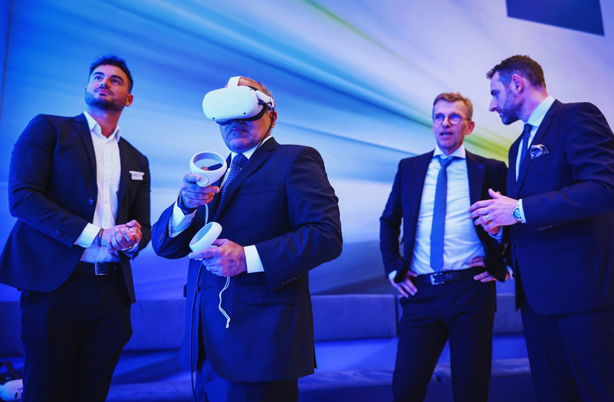
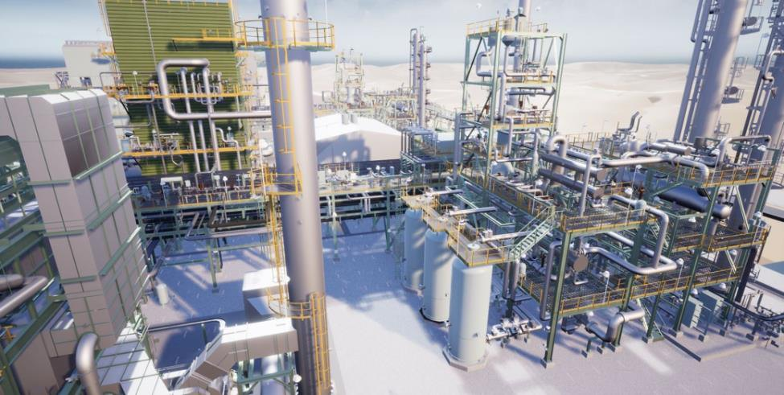
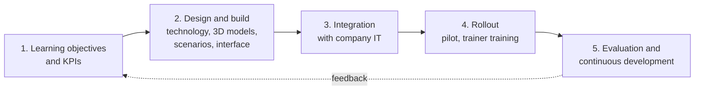

# XR safety training for industry

My master's thesis at Gdańsk University of Technology, 2024: a framework for designing VR safety training for industrial plants and rolling it out in a company. It grew out of my work on the Linde Virtual Academy at Linde Engineering and won the faculty's award for the best master's thesis of 2024.

**[Open the 3-page portfolio (PDF)](https://majewski.studio/assets/xr-training-portfolio.pdf)** with the timeline, the survey numbers and the photos from ACHEMA.

| Role | Setting | Methods | Years |
|---|---|---|---|
| Sole author, supervised by Prof. Edward Szczerbicki | M.Sc. in Management, Gdańsk University of Technology, written alongside my work at Linde Engineering | Literature review of 93 sources, case studies, a survey of 44 industry professionals, expert interviews | 2023 to 2024 |

## Where it came from

From October 2023 I worked in the product team behind the [Linde Virtual Academy](https://www.linde-engineering.com/products-and-services/success-stories/2024/the-benefits-of-virtual-training), Linde Engineering's library of VR trainings for operators of gas and chemical plants, from emergency response to routine procedures. My part was hands-on. I prepared and optimised CAD models for VR, first with Pixyz and later in Blender, tested every training on the headset and on PC, and wrote up reproducible issues for the development partner. I also set up headsets under corporate device management, built a usage-analytics view of how the trainings were used and gave demos to engineering teams, management and trade-fair visitors.

Eleven of the trainings I worked on are published in the [Meta Quest store](https://www.meta.com/experiences/profile/9101055249993942/), along with [a free demo of the academy](https://www.meta.com/experiences/linde-virtual-academy-express/24635128052801851/) released in August 2024. Linde also has [a video about the academy](https://www.youtube.com/watch?v=JKOe9Ji8jdI).

*A plant scene from one of the trainings. Image: Linde Virtual Academy.*

The thesis grew out of that work. The question was how VR safety training has to be designed to work in real plants, since most of the published results come from office and soft-skills training.

## How I worked

- **Literature review:** 93 sources, from learning theory and safety statistics to XR hardware, standards and costs.
- **Case studies:** published VR training projects in the energy, logistics and aviation sectors, compared side by side.
- **Survey:** 44 professionals from industrial sites in Munich, Gdańsk and Rotterdam, piloted with five people first. 64% of them had never used VR.
- **Expert interviews:** people from the Linde Virtual Academy team, from product management to plant layout and piping design. I analysed the transcripts by theme.

## What the survey showed

- 81.8% viewed VR training favourably, and 84.1% thought VR can reproduce real work situations well.
- 75% supported using VR more widely, and most of them (57%) would use it once a quarter.
- The main barrier was cost (18 mentions), ahead of technical problems (10).
- For the future, respondents most often asked for AI-based personalisation (30%) and digital twins (23%).

These are opinions. They show how far people accept VR training and which barriers a rollout has to deal with.

## The framework

It joins established learning theory with what the interviews and my own work showed. What it covers:

- **Design principles:** immersion, learning by doing, immediate feedback, difficulty adapted to the trainee, real work context, gamification, room to make mistakes safely, and a link to the company's learning platform.
- **Goals and KPIs:** SMART objectives, measured through knowledge retention, time to proficiency, errors in real operations and safety indicators.
- **From CAD to VR:** where 3D data comes from (CAD and BIM, laser scans, photogrammetry), decimation, LODs, texture compression, UV layout and baked lighting, and keeping every frame inside 13.9 ms at 72 Hz.
- **Scenarios and interaction:** scenarios built from incident data, near-miss reports and operator interviews, with state machines for branching, collision-based interaction and seeded randomness, so runs differ and stay repeatable.
- **Interface:** controls placed 0.5 to 2 m from the trainee, clear feedback for gestures, and instructions shown as text as well as voice.
- **Integration and rollout:** learning-platform standards (xAPI, SCORM, LTI), data security, network requirements, a four-phase pilot, train-the-trainer and support after launch.

## What came out of it

The main conclusion: VR works best as part of an existing training programme, next to classroom and on-site training, especially where real practice is dangerous or expensive.

In June 2024 I represented the academy at ACHEMA in Frankfurt, the main trade fair of the process industries. There I gave Saudi Arabia's Deputy Minister of Industry and Mineral Resources a one-to-one presentation of one of the trainings (the photo at the top) and presented the whole concept to the company's CEO. [Arab News reported](https://www.arabnews.com/node/2530456) the deputy minister's meetings at ACHEMA, with Linde among the companies. I defended the thesis in October 2024 and graduated with distinction. In March 2025 the Faculty of Management and Economics gave it the award for the best master's thesis of 2024 ([listed on the university's website](https://zie.pg.edu.pl/aktualnosci/2025-03/za-nami-uroczyste-posiedzenie-senatu-pg-z-okazji-promocji-akademickich) under Dyplom Roku).

## Limits

44 survey answers and a handful of interviews make a small sample, and each interview was limited to about 30 minutes. Some company data could only be used under confidentiality. The survey measures opinions, so the framework's effect on learning and safety would still need a controlled study.

## Related

- [Automotive content pipeline](https://github.com/jacobemanuel/automotive-content-pipeline-portfolio): the same CAD-to-real-time problem two years later, for car interiors.
- [Gaussian Splatting on Apple Vision Pro](https://github.com/jacobemanuel/gaussian-splatting-vision-pro): research on real-time 3D for standalone headsets at TUM.

The thesis itself isn't published here, and the names of the people I interviewed are left out. The plant scene belongs to the Linde Virtual Academy.

© 2026 Jakub Majewski. Text: all rights reserved.
